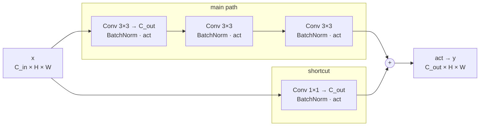
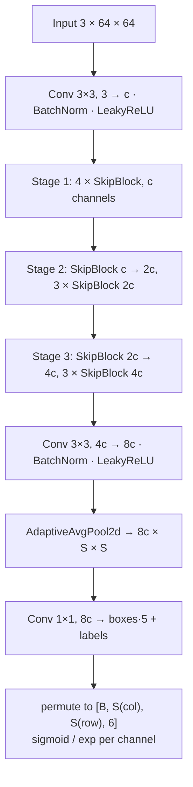
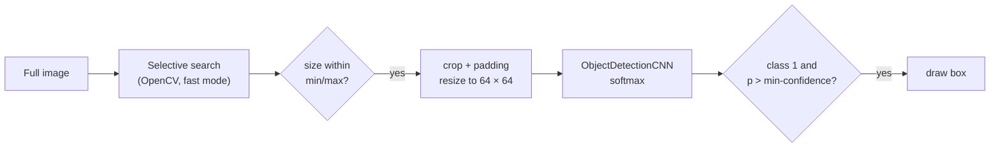

# CNN Website API

The `api/` folder holds the backend of the CNN website. It covers three things:

1. **Training code** for three small PyTorch CNNs:
   - a bird species **classifier** (`Bird_CNN`),
   - a YOLO-style single-shot **face detector** (`Yolo_model`),
   - an R-CNN-style **crop classifier** (`ObjectDetectionCNN`). It is run on
     selective-search proposals.
2. **A production server** (FastAPI). It serves the bird classifier and the
   face detector to the website, and it stores user reviews in SQLite.
3. **Tooling**: one command-line entry point for every task, a run logger
   that records every training run, and an offline HTML viewer to compare
   those runs.

All commands in this document run from the `api/` folder.

---

## Table of contents

- [Quick start](#quick-start)
- [Directory structure](#directory-structure)
- [The command line (`src/main.py`)](#the-command-line-srcmainpy)
- [Command reference](#command-reference)
  - [`bird.*`: bird classifier](#bird-bird-classifier)
  - [`yolo.*`: YOLO face detector](#yolo-yolo-face-detector)
  - [`rcnn.*`: R-CNN-style experiments](#rcnn-r-cnn-style-experiments)
  - [`server.*`: API server](#server-api-server)
- [How the models work](#how-the-models-work)
  - [Shared building block: `SkipBlock`](#shared-building-block-skipblock)
  - [Bird classifier (`Bird_CNN`)](#bird-classifier-bird_cnn)
  - [YOLO face detector (`Yolo_model`)](#yolo-face-detector-yolo_model)
  - [R-CNN-style crop classifier (`ObjectDetectionCNN`)](#r-cnn-style-crop-classifier-objectdetectioncnn)
- [Training infrastructure](#training-infrastructure)
  - [The training loop (`fit`)](#the-training-loop-fit)
  - [Checkpoints](#checkpoints)
  - [Run logs](#run-logs)
  - [Run viewer (`analytics/run_viewer.html`)](#run-viewer-analyticsrun_viewerhtml)
- [Production server](#production-server)
  - [Endpoints](#endpoints)
  - [Settings and environment variables](#settings-and-environment-variables)
  - [Overload protection](#overload-protection)
  - [Running with Docker](#running-with-docker)
  - [Deploying a newly trained model](#deploying-a-newly-trained-model)
- [Datasets](#datasets)
- [Helper scripts](#helper-scripts)
- [Known issues and quirks](#known-issues-and-quirks)

---

## Quick start

```bash
cd api

# 1. Dependencies
pip install torch torchvision                     # CPU or CUDA build, see pytorch.org
pip install -r requirements.txt                   # server + shared dependencies
pip install albumentations matplotlib             # only needed for training and viewing
pip install opencv-contrib-python                 # only for rcnn.detect-* (selective search)

# 2. Datasets (about 14 GB unpacked, only needed for training)
7z x data.7z                                      # creates api/data/

# 3. See every task
python -m src.main

# 4. Train something, or start the server
python -m src.main yolo.train --epochs 50
python -m src.main server.run
```

---

## Directory structure

```
api/
├── src/
│   ├── main.py                 single CLI entry point for every task
│   ├── models/                 network definitions (used by training AND the server)
│   │   ├── bird_cnn.py         Bird_CNN, BirdSpecies, SkipBlock (ReLU)
│   │   ├── yolo.py             Yolo_model, SkipBlock (LeakyReLU), convert_prediction
│   │   └── r_cnn.py            ObjectDetectionCNN
│   ├── common/                 code shared by all groups
│   │   ├── boxes.py            IoU, NMS, box/grid coordinate conversions
│   │   ├── checkpoints.py      save/load state_dicts
│   │   ├── data.py             train/val split with different transforms, collate fn
│   │   ├── device.py           "auto" -> cuda:0 or cpu
│   │   ├── training.py         the training loop (fit) and a DataLoader benchmark
│   │   ├── run_log.py          records every training run to runs/
│   │   └── visualize.py        matplotlib helpers (lazy import)
│   ├── bird_cnn/               "bird" task group:   config.py, tasks.py
│   ├── yolo/                   "yolo" task group:   config.py, tasks.py, dataset.py, loss.py, metrics.py, wider.py, merge.py
│   ├── r_cnn/                  "rcnn" task group:   config.py, tasks.py, dataset.py, crops.py, detect.py
│   └── production/             "server" task group + the FastAPI app
│       ├── app.py              FastAPI app, CORS, startup (load models, create DB)
│       ├── predict.py          POST /predict and websocket /predict_face
│       ├── reviews.py          GET/POST/DELETE /review (SQLite)
│       ├── inference.py        model loading, image decoding, one prediction
│       ├── limits.py           rate limiter, inference thread pool
│       ├── settings.py         all server settings (some via env vars)
│       ├── config.py           settings for `server.run`
│       └── tasks.py            `server.run`
├── build_models/               deployed weights loaded by the server
│   ├── bird_cnn                Bird_CNN state_dict (7 species, 64 px)
│   └── face_detection_yolo     Yolo_model state_dict (see "Known issues")
├── analytics/
│   └── run_viewer.html         offline viewer for runs/ (open it in a browser)
├── data/                       datasets (git-ignored, unpacked from data.7z)
├── data.7z                     dataset archive (git-ignored)
├── saved_models/               best checkpoint per model name (created by training, git-ignored)
├── runs/                       one folder per training run (created by training, git-ignored)
├── database/                   reviews.db and optional .env (created by the server)
├── Dockerfile, .dockerignore   production image (server code only)
├── requirements.txt            Python dependencies of the server
├── start_server.sh             production start command (used by Docker)
├── start_server.bat            local start on Windows
└── train_test.sh               example hyperparameter sweep
```

The code has three layers:

| Layer | Packages | Purpose |
|---|---|---|
| Models | `src/models` | Network definitions only. The server imports them, so they must not depend on training-only libraries. |
| Shared | `src/common` | Generic helpers: training loop, run log, boxes, checkpoints. `boxes.py` and `checkpoints.py` are also used by the server. |
| Task groups | `src/bird_cnn`, `src/yolo`, `src/r_cnn`, `src/production` | Each has a `config.py` (a `Config` dataclass with defaults) and a `tasks.py` (a `TASKS` dict of commands). |

The Docker image contains only `src/production`, `src/models`, `src/common`
and `build_models/` (see `.dockerignore`). Training code and datasets never
end up in the image.

---

## The command line (`src/main.py`)

Every task runs through one entry point:

```bash
python -m src.main                         # list all tasks (also: list, -h, --help)
python -m src.main <group>.<task>          # run a task with its defaults
python -m src.main <group>.<task> --flag value ...
python -m src.main <group>.<task> --help   # list every flag of a task
```

It must run as a module (`python -m src.main`) from `api/`, because the
code imports from `src.…`.

### How flags are generated

There is no hand-written argument parser. `main.py` loads the group's
`Config` dataclass and turns **every field into a flag**:

| Config field | Flag | Example |
|---|---|---|
| `batch_size: int = 64` | `--batch-size INT` | `--batch-size 32` |
| `learning_rate: float = 1e-3` | `--learning-rate FLOAT` | `--learning-rate 3e-4` |
| `train_dir: str = "..."` | `--train-dir STR` | `--train-dir data/faces_scenery/train` |
| `save: bool = True` | `--save` / `--no-save` | `--no-save` |

Rules:

- Underscores become dashes (`c_hidden` → `--c-hidden`).
- Boolean fields get a pair: `--name` sets `True`, `--no-name` sets `False`.
- All tasks in a group share one `Config`. Every task therefore accepts every
  flag of its group, even ones it does not use (e.g. `yolo.webcam --epochs 5`
  is accepted and ignored). The tables below list which flags each task uses.
- `--help` lists the flags but **does not print their defaults**. The defaults
  are in `src/<group>/config.py` and in the tables below.
- To change a default for good, edit `config.py`. To change it for one run,
  pass a flag.

### Running from an IDE

To start a task with the IDE's "Run" button (no arguments), set these at the
top of `src/main.py`:

```python
DEFAULT_TASK = "yolo.train"
DEFAULT_ARGS = ["--epochs", "20"]
```

### Lazy imports

A group's packages are imported only when one of its tasks runs. A missing
training dependency (for example `albumentations`) therefore breaks only the
groups that need it. `python -m src.main` lists such groups as
`(unavailable: ...)`.

### All tasks at a glance

| Task | What it does |
|---|---|
| `bird.train` | Train the bird classifier; keeps the checkpoint with the best validation accuracy. |
| `bird.view-data` | Show a few augmented training images with their labels. |
| `bird.predict` | Classify one image with a saved model. |
| `yolo.train` | Train the face detector; keeps the checkpoint with the lowest validation loss. |
| `yolo.view-data` | Show validation images with their ground-truth grid and boxes. |
| `yolo.sample` | Show the saved model's predictions on validation images. |
| `yolo.benchmark-workers` | Time different DataLoader `num_workers` values. |
| `yolo.webcam` | Live face detection on a local webcam. |
| `rcnn.create-dataset` | Cut face and background crops out of a COCO face dataset. |
| `rcnn.train-faces` | Train the face/background crop classifier. |
| `rcnn.detect-faces` | Selective search + face classifier on one image. |
| `rcnn.train-football` | Train the crop classifier on the football dataset. |
| `rcnn.detect-football` | Selective search + football classifier on a validation image. |
| `server.run` | Start the API server locally with uvicorn. |

---

## Command reference

### `bird.*`: bird classifier

Code: `src/bird_cnn/tasks.py` · Defaults: `src/bird_cnn/config.py` · Model: [`Bird_CNN`](#bird-classifier-bird_cnn)

#### Options

| Flag | Default | Used by | Meaning |
|---|---|---|---|
| `--data-dir` | `data/CUB_200_2011/images` | train, view-data | Image folder with one subfolder per class (torchvision `ImageFolder`). |
| `--train-fraction` | `0.8` | train, view-data | Share of images used for training. The rest is validation. |
| `--image-size` | `128` | all | Images are resized (shorter side) and center-cropped to this size. |
| `--num-classes` | `200` | all | Number of output classes. Must match the dataset or checkpoint. |
| `--c-hidden` | `16` | all | Base channel count of the network. |
| `--epochs` | `500` | train | Number of epochs. |
| `--batch-size` | `64` | train, view-data | Batch size. |
| `--learning-rate` | `1e-3` | train | Adam learning rate. |
| `--weight-decay` | `1e-4` | train | Adam weight decay. |
| `--num-workers` | `0` | train, view-data | DataLoader worker processes. |
| `--device` | `auto` | train, predict | `auto` (CUDA if available, else CPU), `cpu`, `cuda:0`, … |
| `--save-dir` | `saved_models` | train, predict | Root folder of checkpoints. |
| `--model-name` | `bird_cnn` | train, predict | Checkpoint name, saved as `<save-dir>/<model-name>/<model-name>`. |
| `--save` / `--no-save` | `--save` | train | Save the best checkpoint to `save-dir`. |
| `--runs-dir` | `runs` | train | Where run logs go. Empty string disables the run log. |
| `--run-name` | `""` | train | Label appended to the run folder name. |
| `--image` | `test1.jpg` | predict | Image to classify. |
| `--checkpoint` | `""` | predict | Explicit weights file. Empty = `<save-dir>/<model-name>/<model-name>`. |

#### `bird.train`

Trains `Bird_CNN` on an `ImageFolder` dataset, using a random 80/20 split.

- **Training augmentation:** random affine (±35° rotation, ±20 % shift),
  horizontal flip, resize, center crop.
- **Validation:** resize and center crop only.
- **Optimizer and loss:** Adam with cross-entropy loss.
- **Best checkpoint:** chosen by **validation accuracy** (higher is better).

```bash
python -m src.main bird.train
python -m src.main bird.train --epochs 100 --batch-size 32 --image-size 64
python -m src.main bird.train --data-dir data/my_birds --num-classes 7 --run-name seven-species
python -m src.main bird.train --no-save --runs-dir ""          # quick experiment, nothing written
```

Each epoch prints a line like:

```
epoch: 12 | train acc: 41.3% | val acc: 38.9% | train loss: 2.1034 | val loss: 2.2511 | saved
```

`saved` means validation accuracy improved and the checkpoint was written.

#### `bird.view-data`

Opens matplotlib windows with 4 augmented training images and their numeric
labels. Use it to check the augmentation and the data folder. Needs
`matplotlib`.

```bash
python -m src.main bird.view-data
python -m src.main bird.view-data --data-dir data/my_birds --image-size 64
```

#### `bird.predict`

Classifies one image and prints the class and the softmax confidence. Class
names (`BirdSpecies`) are printed only when `--num-classes` is 7, which
matches the deployed model. Otherwise it prints `class <index>`.

```bash
# your own trained checkpoint (saved_models/bird_cnn/bird_cnn)
python -m src.main bird.predict --image path/to/bird.jpg

# the deployed model: 7 classes, 64 px input
python -m src.main bird.predict --image path/to/bird.jpg \
    --checkpoint build_models/bird_cnn --num-classes 7 --image-size 64
```

Output:

```
Using device cpu
Species: Indian_Peacock | Confidence: 0.93
```

`--num-classes`, `--c-hidden` and `--image-size` must match how the checkpoint
was trained. A mismatch in the first two fails while loading.

---

### `yolo.*`: YOLO face detector

Code: `src/yolo/` · Defaults: `src/yolo/config.py` · Model: [`Yolo_model`](#yolo-face-detector-yolo_model)

#### Options

| Flag | Default | Used by | Meaning |
|---|---|---|---|
| `--train-dir` | `data/faces_scenery/train` | train, benchmark-workers | COCO folder: images + annotation file. |
| `--val-dir` | `data/faces_scenery/test` | train, view-data, sample | COCO folder for validation. |
| `--annotation-file` | `_annotations.coco.json` | dataset tasks | Annotation file name inside each folder. |
| `--augment-train` / `--no-augment-train` | on | train, benchmark-workers | Augment training images. |
| `--augment-val` / `--no-augment-val` | **on** | train, view-data, sample | Augment validation images too (historical default, see [quirks](#known-issues-and-quirks)). |
| `--image-size` | `64` | all | Model input size (square). |
| `--grid` | `6` | all | Grid size S: the model predicts an S × S grid. |
| `--wider-dir` | `""` | convert-wider | WIDER FACE folder with `WIDER_train/`, `WIDER_val/` and `wider_face_split/`. |
| `--wider-out-dir` | `data/wider_face` | convert-wider | Output folder; gets `train/` and `test/`. |
| `--wider-min-face` | `2.0` | convert-wider | Drop faces smaller than this (px, after resizing to `--image-size`). |
| `--merge-dirs` | `""` | merge-coco | COCO folders to combine, comma separated. |
| `--merge-out-dir` | `""` | merge-coco | Output folder for the combined dataset. Must not exist yet. |
| `--c-hidden` | `16` | all | Base channel count (c, 2c, 4c, 8c). |
| `--boxes` | `1` | all | Boxes per cell. Only 1 is supported by the dataset, loss and decoder. |
| `--labels` | `1` | all | Number of classes. Must equal the number of categories in the COCO file. |
| `--size-activation` | `sigmoid` | all | How width/height are produced: `sigmoid` or `exp`. Must match the checkpoint. |
| `--epochs` | `500` | train | Number of epochs. |
| `--batch-size` | `64` | train, sample, benchmark-workers | Batch size. |
| `--learning-rate` | `1e-3` | train | Peak AdamW learning rate (reached after the warmup). |
| `--weight-decay` | `0.05` | train | AdamW weight decay, applied to conv weights only (not biases or BatchNorm). |
| `--warmup-epochs` | `3` | train | Linear warmup from `learning-rate / 10` to `learning-rate`. `0` disables it. |
| `--min-learning-rate` | `1e-5` | train | Cosine decay ends at this value in the last epoch. |
| `--train-workers` | `2` | train | DataLoader workers for training. |
| `--val-workers` | `0` | train | DataLoader workers for validation. |
| `--device` | `auto` | train, sample, benchmark-workers, webcam | `auto`, `cpu`, `cuda:0`, … |
| `--save-dir` | `saved_models` | train, sample, webcam | Root folder of checkpoints. |
| `--model-name` | `face_detection_yolo` | train, sample, webcam | Checkpoint name. |
| `--save` / `--no-save` | `--save` | train | Save the best checkpoint. |
| `--runs-dir` | `runs` | train | Run log folder. Empty disables it. |
| `--run-name` | `""` | train | Label appended to the run folder name. |
| `--checkpoint` | `""` | sample, webcam | Explicit weights file. Empty = `<save-dir>/<model-name>/<model-name>`. |
| `--threshold` | `0.95` | view-data, sample, webcam | Minimum confidence for a box to be drawn. |
| `--camera` | `0` | webcam | OpenCV webcam index. |

#### `yolo.train`

Trains the detector on COCO-format data.

- **Optimizer and loss:** AdamW with [`YoloLoss`](#loss). Weight decay only applies to
  conv weights; biases and BatchNorm parameters are not decayed.
- **Learning rate:** linear warmup for `--warmup-epochs`, then cosine decay from
  `--learning-rate` to `--min-learning-rate` at the last epoch. The `lr` column
  of the run log shows the value each epoch trained with.
- **Best checkpoint:** chosen by **validation `conf_ap`** (higher is better).
  Validation loss tends to keep falling after the detection quality peaks.
- **Extra validation metrics:** after every epoch it also computes
  [detection metrics](#validation-metrics) on the whole validation set:
  `conf_ap`, `box_iou`, `precision` and `recall`.

```bash
python -m src.main yolo.train
python -m src.main yolo.train --epochs 50 --batch-size 32
python -m src.main yolo.train --no-augment-val --run-name clean-val
python -m src.main yolo.train --c-hidden 8 --grid 8 --image-size 96 --run-name small-g8
python -m src.main yolo.train --size-activation exp
python -m src.main yolo.train --device cpu --train-workers 0 --epochs 1   # smoke test
```

Example epoch line:

```
epoch: 7 | train loss: 0.0912 | val loss: 0.1034 | val conf_ap: 0.812 | val box_iou: 0.604 | val precision: 0.702 | val recall: 0.655 | saved
```

#### `yolo.view-data`

Loads the validation set and shows one random image at a time, with its
**ground truth** drawn on it (matplotlib; close the window to see the next
image). It runs the target tensor through the same decoder as a prediction,
so it also checks the target encoding.

- **Red:** ground-truth boxes.
- **Blue:** grid cells that contain a face centre.
- **Green:** empty grid cells.

```bash
python -m src.main yolo.view-data
python -m src.main yolo.view-data --no-augment-val          # see the images as they really are
```

#### `yolo.sample`

Loads a trained checkpoint and runs it on the validation set batch by batch.
It prints the inference time per batch and shows every image with its
**predictions**, using the same colours as `view-data`.

```bash
python -m src.main yolo.sample
python -m src.main yolo.sample --threshold 0.8 --batch-size 8
python -m src.main yolo.sample --checkpoint runs/face_detection_yolo/20261003-101500_bn-c16/best.pt
```

The model flags (`--c-hidden`, `--grid`, `--image-size`, `--size-activation`)
must match the checkpoint.

#### `yolo.benchmark-workers`

Builds the training set and times 2 full passes over it (forward pass only)
for `num_workers` = 0, 2, 4, … up to the CPU count. Use the fastest value as
`--train-workers`. On the full dataset this takes a while.

```bash
python -m src.main yolo.benchmark-workers --batch-size 64
```

#### `yolo.webcam`

Live detection on a local webcam in an OpenCV window. Press **q** to quit.
Every frame is resized to `--image-size` and run through the model. Boxes are
scaled back to the frame size: thick red for detections, thin blue for cells
with a face, thin green for empty cells.

```bash
python -m src.main yolo.webcam
python -m src.main yolo.webcam --camera 1 --threshold 0.9
```

Needs an OpenCV build with GUI support (`opencv-python`, not the `-headless`
variant from `requirements.txt`).

#### `yolo.convert-wider`

Converts the [WIDER FACE](http://shuoyang1213.me/WIDERFACE/) dataset into the
COCO folders `yolo.train` reads. `WIDER_train` becomes `<wider-out-dir>/train`
and `WIDER_val` becomes `<wider-out-dir>/test`. WIDER's own test split has no
public boxes, so it is not converted. The images are copied into each folder
(flat) next to `_annotations.coco.json`, with one category, 1 = face.

`--wider-dir` must contain the unpacked `WIDER_train.zip`, `WIDER_val.zip`
and `wider_face_split.zip`. The files are found anywhere below it, so nested
unzips like `WIDER_train/WIDER_train/images` also work.

WIDER is mostly crowds of tiny faces, so the conversion filters for what the
model can learn from:

- **Small faces:** faces narrower or shorter than `--wider-min-face` px
  after resizing to `--image-size` are dropped. Faces marked `invalid` are
  dropped as well.
- **Shared cells:** an image is skipped when two face centres fall in the
  same `--grid` cell. The dataset keeps one face per cell, so the other face
  would be trained as background.
- **Boxes:** clipped to the image and stored in whole pixels.
- **Unreadable images:** images OpenCV cannot read are skipped.

Convert with the same `--image-size` and `--grid` you train with. The task
refuses to overwrite existing `train/` or `test/` folders.

```bash
python -m src.main yolo.convert-wider --wider-dir ~/Downloads/wider_face
python -m src.main yolo.convert-wider --wider-dir ~/Downloads/wider_face --image-size 128 --grid 8 --wider-out-dir data/wider_face_128
python -m src.main yolo.train --train-dir data/wider_face/train --val-dir data/wider_face/test
```


#### `yolo.merge-coco`

Combines two or more COCO folders into one, for example to train on WIDER and
`faces_scenery` together. Run it once per split.

```bash
python -m src.main yolo.merge-coco \
  --merge-dirs data/wider_faces_coco/train,data/faces_scenery/train --merge-out-dir data/faces_combined/train
python -m src.main yolo.merge-coco \
  --merge-dirs data/wider_faces_coco/test,data/faces_scenery/test --merge-out-dir data/faces_combined/test
```

- **Images:** hard-linked into the output folder, so they take no extra disk
  space. If the folders are on different drives, they are copied instead.
  Each file is renamed `<source>__<file_name>`, e.g.
  `faces_scenery_train__0001.jpg`, so names from different sources never clash.
- **Ids:** image and annotation ids are renumbered.
- **Categories:** merged by name and numbered 1, 2, … in order of first
  appearance. The same class in both sources becomes one class. The task
  prints the merged list; `--labels` must equal its length.
- **Checks:** before writing anything, it stops if a source has no annotation
  file, if an image listed in it is missing, or if `--merge-out-dir` already exists.

The sources are combined as they are. Prepare each one with the same
`--image-size` and `--grid` you train with (see `yolo.convert-wider`).

---

### `rcnn.*`: R-CNN-style experiments

Code: `src/r_cnn/` · Defaults: `src/r_cnn/config.py` · Model: [`ObjectDetectionCNN`](#r-cnn-style-crop-classifier-objectdetectioncnn)

These are older experiments. The idea: train a classifier on image crops,
then classify region proposals from selective search. They are not used by
the website.

#### Options

| Flag | Default | Used by | Meaning |
|---|---|---|---|
| `--faces-raw-dir` | `data/faces/train` | create-dataset | COCO face dataset to cut crops from. |
| `--faces-processed-dir` | `data/faces_processed` | create-dataset, train-faces | Output/input `ImageFolder` with `face/` and `background/`. |
| `--football-train-dir` | `data/football/train` | train-football | COCO football training set. |
| `--football-val-dir` | `data/football/valid` | train-football, detect-football | COCO football validation set. |
| `--annotation-file` | `_annotations.coco.json` | COCO tasks | Annotation file name. |
| `--crop-size` | `64` | all | Crops are resized to this square size. |
| `--padding` | `40` | train-football, detect-football | Extra pixels around each box/proposal. |
| `--backgrounds-per-image` | `10` | create-dataset | Random background crops per image. |
| `--train-fraction` | `0.8` | train-faces | Train/validation split. |
| `--c-hidden` | `32` | all | Channels per conv layer. |
| `--layers` | `10` | all | Number of conv layers. |
| `--num-classes` | `2` | all | Output classes. **Use 5 for football** (see below). |
| `--epochs` | `200` | train-* | Number of epochs. |
| `--batch-size` | `256` | train-faces | Batch size (pre-cut crops). |
| `--football-batch-size` | `2` | train-football | Full images per batch (crops are cut on the fly). |
| `--learning-rate` | `1e-3` | train-* | Adam learning rate. |
| `--weight-decay` | `1e-4` | train-* | Adam weight decay. |
| `--background-weight` | `0.333` | train-faces | Loss weight of the background class (there are ~3× more backgrounds). |
| `--device` | `auto` | train-*, detect-* | Device. |
| `--save-dir` | `saved_models` | train-*, detect-* | Root folder of checkpoints. |
| `--faces-model-name` | `face_detection` | train-faces, detect-faces | Checkpoint name of the face classifier. |
| `--football-model-name` | `object_detection` | train-football, detect-football | Checkpoint name of the football classifier. |
| `--save` / `--no-save` | `--save` | train-* | Save the best checkpoint. |
| `--runs-dir`, `--run-name` | `runs`, `""` | train-* | Run log, as for the other groups. |
| `--image` | `""` | detect-faces | Image to run on (required). |
| `--min-size` | `5` | detect-* | Ignore proposals narrower/shorter than this (px). |
| `--max-size` | `600` | detect-faces | Ignore proposals wider/taller than this (px). |
| `--min-confidence` | `0.97` | detect-faces | Minimum "face" probability for a detection. |
| `--football-max-size` | `100` | detect-football | Max proposal size for football. |
| `--football-min-confidence` | `0.8` | detect-football | Minimum class-1 probability for football. |

#### `rcnn.create-dataset`

Reads the COCO face dataset and writes an `ImageFolder` dataset:

- `face/N.jpg`: every annotated face box (category 1), resized to `crop-size`.
- `background/N.jpg`: per image, up to `backgrounds-per-image` random crops
  of 50–600 px that overlap no face at all (IoU = 0).

```bash
python -m src.main rcnn.create-dataset
python -m src.main rcnn.create-dataset --backgrounds-per-image 5 --faces-processed-dir data/faces_processed_v2
```

Existing files with the same number are overwritten. Delete the output folder
first for a clean dataset.

#### `rcnn.train-faces`

Trains the crop classifier on `faces-processed-dir`. Classes are sorted
alphabetically: `0 = background`, `1 = face`.

- **Augmentation:** horizontal flip and ±15° rotation.
- **Loss:** cross-entropy with class weights `[background-weight, 1.0]`.
- **Best checkpoint:** chosen by **validation loss**. Accuracy is printed too.
- **Saved to:** `saved_models/face_detection/face_detection`.

```bash
python -m src.main rcnn.train-faces
python -m src.main rcnn.train-faces --layers 6 --c-hidden 16 --epochs 50
```

#### `rcnn.detect-faces`

Runs the full R-CNN-style pipeline on one image:

1. OpenCV fast selective search proposes regions.
2. Proposals outside `[min-size, max-size]` are skipped.
3. Each proposal is cropped, resized to `crop-size` and classified.
4. Proposals classified as face with probability > `min-confidence` are drawn.

Two OpenCV windows open one after the other (press any key to continue): the
input image, then the detections. There is no NMS, so overlapping boxes are
expected.

```bash
python -m src.main rcnn.detect-faces --image path/to/photo.jpg
python -m src.main rcnn.detect-faces --image photo.jpg --min-confidence 0.99 --max-size 300
```

Needs `opencv-contrib-python` (for `cv2.ximgproc`) and a trained
`saved_models/face_detection/face_detection`. This task has no `--checkpoint`
flag. Use `--save-dir` / `--faces-model-name` to point it at other weights.

#### `rcnn.train-football`

Trains the crop classifier directly on the football COCO dataset.

- **Batches:** `football-batch-size` full images per batch. Every annotated
  box (plus `padding` px) is cut out and resized on the fly, and the boxes'
  category ids are the labels.
- **No background class:** no background crops are added.
- **Best checkpoint:** chosen by validation loss.
- **Saved to:** `saved_models/object_detection/object_detection`.

The football annotations use category ids 1–4 (ball, goalkeeper, player,
referee). With the default `--num-classes 2` the loss fails on the first batch
with labels ≥ 2. Pass `--num-classes 5`:

```bash
python -m src.main rcnn.train-football --num-classes 5
python -m src.main rcnn.train-football --num-classes 5 --padding 20 --football-batch-size 4
```

#### `rcnn.detect-football`

Picks one random validation image and runs the selective-search pipeline with
`padding`, `football-max-size` and `football-min-confidence`. Proposals whose
top class is **1 (ball)** are drawn.

```bash
python -m src.main rcnn.detect-football --num-classes 5
```

`--num-classes` must match the trained checkpoint.

---

### `server.*`: API server

Code: `src/production/` · Defaults: `src/production/config.py`

| Flag | Default | Meaning |
|---|---|---|
| `--host` | `127.0.0.1` | Interface to bind. Use `0.0.0.0` to accept connections from other machines. |
| `--port` | `8000` | Port. |
| `--reload` / `--no-reload` | `--reload` | Restart on code changes (development). |
| `--ws-max-size` | `1048576` | Largest websocket message in bytes. |

#### `server.run`

Starts the FastAPI app (`src.production.app:app`) with uvicorn. It loads both
models from `build_models/` and creates `database/reviews.db` if needed.

```bash
python -m src.main server.run
python -m src.main server.run --host 0.0.0.0 --port 8080 --no-reload
```

Then open <http://127.0.0.1:8000/docs> for FastAPI's interactive API docs, or
call `GET /health`.

These flags only set how uvicorn starts. Server behaviour (limits, origins,
model files) is set in `src/production/settings.py` and through
[environment variables](#settings-and-environment-variables).

> **Note:** `server.run` currently fails at startup, because the deployed face
> detector weights no longer match `Yolo_model`. See
> [Known issues](#known-issues-and-quirks).

---

## How the models work

All three networks are plain fully convolutional CNNs. None of them
downsamples with strides or max pooling: all conv layers run at the full
input resolution, and only a final adaptive average pool reduces the spatial
size. This keeps the parameter count small but makes compute grow with the
square of the input size.

### Shared building block: `SkipBlock`

`Bird_CNN` and `Yolo_model` are built from a residual block. Each model file
has its own copy (`models/bird_cnn.py` uses ReLU, `models/yolo.py` uses
LeakyReLU).



- **Main path:** three 3 × 3 convolutions, each followed by BatchNorm and the
  activation.
- **Shortcut:** a 1 × 1 convolution, so the block can change the channel count.
- **Output:** the two paths are added and passed through the activation again.
- **Size:** padding keeps the spatial size unchanged.

> **Layer names are the file format.** The weights in `build_models/` and
> `saved_models/` are plain `state_dict`s keyed by names such as
> `model.3.conv.0.weight`. Adding, removing or reordering layers in a model
> class makes existing checkpoints fail to load.

### Bird classifier (`Bird_CNN`)

File: `src/models/bird_cnn.py`

```
Input 3 × S × S
 └─ Conv 3×3 (3 → c) · BatchNorm · ReLU
 └─ 4 × SkipBlock (c → c)
 └─ SkipBlock (c → 2c), 3 × SkipBlock (2c → 2c)
 └─ Conv 3×3 (2c → 4c) · ReLU
 └─ AdaptiveAvgPool2d → 4c × 1 × 1 · Flatten
 └─ Linear (4c → classes)
 └─ Dropout 0.3
Output: logits [batch, classes]
```

| Variant | `c_hidden` | Classes | Input | Parameters |
|---|---|---|---|---|
| Deployed (`build_models/bird_cnn`) | 16 | 7 (`BirdSpecies`) | 64 × 64 | 159,975 |
| Training default (CUB-200) | 16 | 200 | 128 × 128 | 172,520 |

- **Classes of the deployed model** (`BirdSpecies`): Common_Kingfisher,
  Common_Myna, House_Crow, Indian_Peacock, Indian_Pitta, Ruddy_Shelduck,
  Sarus_Crane. The enum order is the class index.
- **Prediction:** softmax over the logits. The top class and its probability
  are the result.
- **Dropout placement:** dropout comes after the final `Linear`. During
  training it zeroes random logits. In `eval()` mode it does nothing.
- **Speed:** about 6.5 ms per 64 px image on one CPU thread (measured on the
  dev machine).

### YOLO face detector (`Yolo_model`)

Files: `src/models/yolo.py` (model and decoder), `src/yolo/dataset.py`
(targets), `src/yolo/loss.py`, `src/yolo/metrics.py`

A single-shot detector in the style of YOLO v1. The image is split into an
S × S grid (default 6 × 6). Each cell predicts at most one face: the face
whose **centre** falls into that cell.

#### Architecture



- **Resolution:** every layer before the pool runs at the full 64 × 64.
- **Receptive field:** 38 stacked 3 × 3 convolutions give a receptive field of
  77 px, so every output cell can see the whole image.
- **Uneven pooling:** 64 is not divisible by 6, so the adaptive pool averages
  bins of 10–11 px.
- **Parameters by `c_hidden`** (1 box, 1 label, 6 × 6 grid):

| `c_hidden` | 1 | 2 | 4 | 8 | 16 (default) | 32 |
|---|---|---|---|---|---|---|
| Parameters | 2,984 | 11,042 | 42,398 | 166,070 | 657,254 | 2,614,982 |

At `c_hidden=16` one 64 px image takes about 23 ms on one CPU thread.

#### Output encoding

`forward` returns `[batch, S, S, boxes·5 + labels]`. With 1 box and 1 label
that is `[batch, 6, 6, 6]`. The first grid index `i` is the **column**
(horizontal) and the second `j` is the **row** (vertical). The model
permutes its `[C, row, col]` feature map so that it matches the targets.

| Channel | Meaning | Range |
|---|---|---|
| 0 | `x`: box centre inside the cell, as a fraction of the cell width | 0–1 (sigmoid) |
| 1 | `y`: box centre inside the cell, as a fraction of the cell height | 0–1 (sigmoid) |
| 2 | `w`: box width as a fraction of the image width | sigmoid: 0–1, exp: > 0 |
| 3 | `h`: box height as a fraction of the image height | sigmoid: 0–1, exp: > 0 |
| 4 | confidence that a face centre lies in this cell | 0–1 (sigmoid) |
| 5… | class scores (one per label) | 0–1 (sigmoid) |

`size_activation` decides how `w` and `h` are produced:

- `"sigmoid"` (training default): bounded to 0–1, which matches the target range.
- `"exp"`: unbounded. The deployed weights were trained this way.

A checkpoint must always run with the activation it was trained with. A
mismatch does **not** raise an error; it silently produces wrong box sizes.

#### From prediction to boxes (`convert_prediction`)

`convert_prediction(label, image, threshold)` turns one `[S, S, 5+C]` tensor
(a prediction or a target) into pixel boxes:

1. Skip every cell whose confidence is below `threshold`.
2. Decode each remaining cell `[i, j]`, with cell size `c = image_size / S`:

   ```
   centre_x = (i + x) · c        width  = w · image_size
   centre_y = (j + y) · c        height = h · image_size
   box = [centre_x − width/2, centre_y − height/2, … + width, … + height]   (min 1 px)
   ```

3. Apply non-maximum suppression (`common/boxes.py: nms`). Boxes are sorted by
   confidence; every box that overlaps a kept box with IoU ≥ 0.1 is dropped.
   The low threshold suits faces, which rarely overlap.

It returns `(boxes, cells_with_object, empty_cells)`. The two cell lists are
only used for drawing.

#### Training targets (`YoloDataset`)

`YoloDataset` reads a COCO folder and returns `(image, target)`.

- **Image:** a `3 × 64 × 64` float tensor in [0, 1].
- **Target:** an `S × S × (5 + classes)` tensor:
  - Annotations are sorted by area, **largest first**. COCO
    `[xmin, ymin, w, h]` boxes are truncated to integers.
  - Each cell takes the first (largest) still-unassigned face whose centre lies
    in it. Each face is assigned to at most one cell, so a cell never holds
    more than one face.
  - For that cell, `x, y` is the centre's offset inside the cell divided by
    the cell size, and `w, h` is the box size divided by the image size.
    Confidence is 1, and the class is one-hot (`category_id − 1`).
  - All other cells are zero.
- **Augmentation** (albumentations, if `augment`):
  - horizontal flip (p = 0.5)
  - brightness/contrast (p = 0.2)
  - affine: ±40 % translation, 0.5–1.5× scale, replicated borders (p = 0.5)
  - resize to 64 × 64
  - boxes that keep less than 50 % of their area are dropped
- **Without augmentation:** resize only. Boxes below 30 % visibility are
  dropped.

#### Loss

`YoloLoss` is the sum of four **unweighted** terms. Each term is averaged
over its own set of cells:

| Term | Cells | Function |
|---|---|---|
| box | cells with a face | MSE on `(x, y, w, h)` |
| object | cells with a face | MSE on confidence vs. 1 |
| no-object | empty cells | MSE on confidence vs. 0 |
| class | cells with a face | binary cross-entropy on the (already sigmoid) class scores |

Because each term is a mean, the ~35 empty cells together weigh the same as
the one or two face cells. The original YOLO paper uses λ factors for this
balance instead.

#### Validation metrics

`src/yolo/metrics.py` computes these over the whole validation set after each
epoch. Like the loss, they work per grid cell:

| Metric | Meaning |
|---|---|
| `conf_ap` | Average precision of the confidence as a ranking of "cell has a face" vs. "empty cell" (1 = perfect). |
| `box_iou` | Mean IoU between predicted and true box in cells that hold a face. |
| `precision` | Correct detections / all detections. A detection is a cell with confidence > 0.5; it is correct if the cell holds a face and IoU > 0.5. |
| `recall` | Correct detections / cells that hold a face. |

They appear in the console, in `metrics.csv` (as `val_conf_ap`, …) and in the
run viewer.

### R-CNN-style crop classifier (`ObjectDetectionCNN`)

File: `src/models/r_cnn.py`

```
Input 3 × 64 × 64
 └─ Conv 3×3 (3 → c) · BatchNorm · ReLU
 └─ (layers − 1) × [Conv 3×3 (c → c) · BatchNorm · ReLU]
 └─ AdaptiveAvgPool2d → c · Flatten · Linear (c → classes) · Dropout 0.3
Output: logits [batch, classes]
```

With the defaults (`c_hidden=32`, `layers=10`, 2 classes) it has 84,834
parameters. It has no skip connections.

The detection pipeline (`src/r_cnn/detect.py`) follows the classic R-CNN
idea:



It runs one forward pass per proposal (often thousands per image), so it is
far slower than the single-shot YOLO model. That is why the website uses YOLO.

---

## Training infrastructure

### The training loop (`fit`)

`src/common/training.py: fit(...)` is the single training loop used by every
`train` task. Every epoch it does the following:

1. **Train:** one pass over the training loader (with a tqdm progress bar)
   that updates the weights.
2. **Validate:** one pass under `no_grad`. The **validation loss is computed
   once over the concatenated predictions of the whole validation set**, so it
   does not depend on the batch size. Optional extra metrics
   (`val_metrics`, e.g. YOLO's detection metrics) are computed the same way.
3. **Compare:** checks the monitored metric against the best so far.
   - `monitor="loss"`: lower is better (R-CNN).
   - any other metric, e.g. `"acc"` (bird) or `"conf_ap"` (YOLO): higher is better.
4. **Save on improvement:** if it improved, saves the checkpoint (`--save`)
   and the run's `best.pt`.
5. **Log:** prints one summary line and appends a row to the run log.
6. **Schedule:** steps the optional `scheduler` (YOLO uses `warmup_cosine`).

`training.py` also has the optimizer helpers YOLO uses: `adamw(model, lr,
weight_decay)` (no decay on biases and BatchNorm) and `warmup_cosine(...)`.

Tasks plug in their own batch handling with `prepare_batch`. For example,
`rcnn.train-football` cuts crops out of full images there.

`benchmark_num_workers(...)` (used by `yolo.benchmark-workers`) times
DataLoader passes for different worker counts.

### Checkpoints

`src/common/checkpoints.py`:

- **Save path:** `<save_dir>/<model_name>/<model_name>`, for example
  `saved_models/face_detection_yolo/face_detection_yolo`. Only the **best**
  epoch is kept, and each improvement overwrites the file.
- **Format:** a plain `state_dict` (`torch.save(model.state_dict())`).
- **Loading:** `torch.load(..., weights_only=True, map_location=device)`, then
  `eval()`. Weights trained on a GPU therefore load on a CPU-only machine.

Turn saving off with `--no-save`. The run log still keeps its own `best.pt`.

### Run logs

`src/common/run_log.py` records every training run in its own folder, so runs
with different settings or architectures can be compared later:

```
runs/<model_name>/<YYYYmmdd-HHMMSS>[_<run-name>]/
├── run.json          config, command, model (class, params, architecture hash),
│                     optimizer, loss settings, data sizes, environment (host,
│                     torch, CUDA, GPU, seed), git state and the result.
│                     Rewritten after every epoch.
├── metrics.csv       one row per epoch: epoch, train_*, val_*, lr, seconds, improved
├── architecture.txt  str(model), the module tree
├── changes.diff      uncommitted code changes at start (only if there are any)
└── best.pt           state_dict of the best epoch so far
```

- **`result.status`** in `run.json` is `running` during training, then
  `completed`, `failed` (with the error) or `interrupted` (Ctrl+C). A process
  that is killed hard stays `running`.
- **Disable it** with `--runs-dir ""`.
- **Name a run** with `--run-name`. The name is appended to the timestamp
  folder, e.g. `20261003-141210_bn-c16`.
- **Use a run's weights** with `--checkpoint runs/<model>/<run>/best.pt` in
  `yolo.sample`, `yolo.webcam` or `bird.predict`.

### Run viewer (`analytics/run_viewer.html`)

A self-contained HTML page to browse and compare run logs. It has no server,
no network access and no external libraries.

1. Open `api/analytics/run_viewer.html` directly in a browser (double-click it).
2. Click **Open runs folder** and pick `api/runs` (or one model or run folder
   inside it), or drag folders onto the page.
3. Optionally tick **Live refresh** to re-read the folder every 10 seconds
   while training runs (Chrome/Edge).

What it shows:

- **Runs table**: every run with its status, best metrics and the settings
  that differ between runs (marked ⚙). You can filter by text, model, series
  and status. Click rows to select up to 8 runs, or use
  "Select best 8 by val loss".
- **Training curves**: any metric, validation and/or training, with log scale
  and smoothing.
- **Settings vs. result**: a scatter plot of any setting against any result
  over all listed runs, e.g. `c_hidden` vs. best val loss.
- **Compare selected runs**: a side-by-side table of config and results,
  optionally only the rows that differ.
- **Architecture**: one run's `architecture.txt`, or the diff between two runs.
- **Code changes**: the `changes.diff` that was in the working tree when a run
  started.

Folders between `runs/` and `<model>/` are treated as a **series**. For
example, runs moved to `runs/sweep-c/face_detection_yolo/...` can be filtered
as series `sweep-c`.

---

## Production server

Files: `src/production/`. App object: `src.production.app:app`.

At startup (`lifespan`) the server:

1. Configures logging. It warns if `API_KEY` is unset.
2. Loads `build_models/bird_cnn` and `build_models/face_detection_yolo` onto
   CUDA if available, else CPU.
3. Creates the SQLite table `reviews` in `database/reviews.db` if it is
   missing.

CORS allows only the origins in `settings.ORIGINS`
(`https://marvinkrausser.com`), with methods GET, POST and DELETE.

### Endpoints

| Method | Path | Auth | Rate limit | Purpose |
|---|---|---|---|---|
| GET | `/health` | none | none | Liveness check, returns `{"status": "ok"}`. |
| POST | `/predict` | none | `PREDICT_RATE_LIMIT` per IP | Classify a bird image. |
| WS | `/predict_face` | origin check | connection limits + FPS cap | Live face detection on a stream of frames. |
| POST | `/review` | none | `REVIEW_RATE_LIMIT` per IP | Store a review. |
| GET | `/review` | `Bearer API_KEY` | none | List reviews. |
| DELETE | `/review` | `Bearer API_KEY` | none | **Delete all reviews.** |

FastAPI also serves its auto-generated docs at `/docs` and `/openapi.json`.

#### `POST /predict`: bird classification

Send the image as multipart form data in the field `file`. Any format Pillow
can read works (the website sends JPEG).

```bash
curl -F "file=@bird.jpg" http://127.0.0.1:8000/predict
```

```json
{"class": "Indian_Peacock", "confidence": 0.9312}
```

**Processing:**

1. The upload is read in 64 KB chunks and rejected above `MAX_UPLOAD_BYTES`.
2. Pillow opens it lazily. Images above 20 megapixels are rejected before
   decoding, and JPEGs are decoded at reduced scale (≈ 256 px).
3. The image is resized (shorter side) and center-cropped to 64 × 64, then
   classified on an inference worker thread.

**Errors:**

| Status | When |
|---|---|
| 400 | Not a valid image, or image too large (pixels). |
| 413 | Upload larger than `MAX_UPLOAD_MEGABYTES`. |
| 422 | No `file` field. |
| 429 | Over the per-IP rate limit (`Retry-After: 60`). |
| 503 | All inference slots and the queue are full (`Retry-After: 5`). |

#### `WS /predict_face`: live face detection

The client opens a websocket and sends webcam frames as **binary messages**
(encoded images, e.g. JPEG). For each processed frame the server replies with
JSON:

```json
{"bboxes": [[xmin, ymin, xmax, ymax], ...]}
```

Box coordinates are integer pixels **in the frame's original size**. Each
frame is resized to 64 × 64 without keeping the aspect ratio, decoded with
`convert_prediction` (`FACE_THRESHOLD = 0.9`, NMS) and scaled back.

**Rules:**

- **Origin:** the `Origin` header must be in `settings.ORIGINS`. CORS does
  not cover websockets, so the server checks it itself.
- **Connections:** at most `MAX_WEBSOCKETS` (3) in total, and
  `MAX_WEBSOCKETS_PER_IP` (1) per IP.
- **Frame rate:** at most `FACE_MAX_FPS` frames per second per connection are
  processed. Faster frames, and frames that arrive while all inference slots
  are busy, are **silently dropped** (no reply).
- **Frame size:** each frame must be ≤ 1 MB.

**Close codes:**

| Code | Reason |
|---|---|
| 1008 | Origin not allowed. |
| 1013 | Too many connections (try again later). |
| 1009 | Frame larger than 1 MB. |
| 1003 | Text message instead of binary, or not a valid image. |
| 1011 | Unexpected server error. |

Minimal Python client (for local testing, add your origin to `ORIGINS` first):

```python
import asyncio, json, websockets

async def main():
    async with websockets.connect("ws://127.0.0.1:8000/predict_face",
                                  origin="https://marvinkrausser.com") as ws:
        await ws.send(open("face.jpg", "rb").read())
        print(json.loads(await ws.recv()))

asyncio.run(main())
```

#### Reviews: `POST/GET/DELETE /review`

`POST /review` is public on purpose (rate-limited only):

```bash
curl -X POST http://127.0.0.1:8000/review \
     -H "Content-Type: application/json" \
     -d '{"website": "cnn", "rating": 5, "text": "Nice demo!"}'
# {"status": "ok"}
```

| Field | Rule |
|---|---|
| `website` | string, 1–100 characters |
| `rating` | integer 1–5 |
| `text` | string, at most 1000 characters (whitespace is trimmed) |

Extra fields, such as the website's `date`, are ignored. The server stores its
own UTC timestamp in `created_at`. Invalid input returns 422.

`GET` and `DELETE` need the API key:

```bash
curl -H "Authorization: Bearer $API_KEY" "http://127.0.0.1:8000/review?limit=50&offset=0"
# {"data": [{"id": 12, "website": "cnn", "rating": 5, "text": "...", "created_at": "..."}, ...]}

curl -X DELETE -H "Authorization: Bearer $API_KEY" http://127.0.0.1:8000/review
# deletes EVERY review
```

- **Paging:** `limit` is 1–500 (default 100) and `offset` ≥ 0. Rows are
  newest first.
- **Errors:** a missing or wrong key returns 401. If `API_KEY` is not set at
  all, both endpoints always return 401.

### Settings and environment variables

All server settings live in `src/production/settings.py`. Those marked
**env** can be set as environment variables (e.g. in `compose.yaml`).
`API_KEY` can also come from `database/.env`.

**Paths and secrets**

| Setting | Default | env | Meaning |
|---|---|---|---|
| `BUILD_PATH` | `api/build_models` | ✔ | Folder with the deployed weights. |
| `DATABASE_DIR` | `api/database` | ✔ | Folder of `reviews.db` and the optional `.env`. |
| `API_KEY` | unset | ✔ | Key for `GET`/`DELETE /review`. Unset = these endpoints are disabled. |
| `ORIGINS` | `["https://marvinkrausser.com"]` | | Allowed CORS / websocket origins. |

**Models.** These must match how the deployed weights were trained.

| Setting | Default | Meaning |
|---|---|---|
| `BIRD_MODEL_FILE` | `bird_cnn` | File in `BUILD_PATH`. |
| `BIRD_IMAGE_SIZE` | `64` | Input size of the bird model. |
| `BIRD_C_HIDDEN` | `16` | `c_hidden` of the bird model. |
| `FACE_MODEL_FILE` | `face_detection_yolo` | File in `BUILD_PATH`. |
| `FACE_IMAGE_SIZE` | `64` | Input size of the face model. |
| `FACE_GRID` | `6` | Grid size. |
| `FACE_C_HIDDEN` | `16` | `c_hidden` of the face model. |
| `FACE_SIZE_ACTIVATION` | `"exp"` | `"exp"` or `"sigmoid"`. Must match training. |
| `FACE_THRESHOLD` | `0.9` | Minimum confidence for a returned box. |

**Resource limits**

| Setting | Default | env | Meaning |
|---|---|---|---|
| `PARALLEL_INFERENCES` | `1` | ✔ | Predictions (bird or face) running at the same time. |
| `QUEUED_INFERENCES` | `1` | ✔ | Extra predictions allowed to wait. Beyond that: 503 / dropped frame. |
| `TORCH_THREADS` | `1` | ✔ | PyTorch threads per running prediction. Keep `PARALLEL_INFERENCES × TORCH_THREADS` ≤ CPU cores. |
| `MAX_UPLOAD_MEGABYTES` | `15` | ✔ | Max upload for `/predict`. |
| `MAX_FRAME_BYTES` | 1 MB | | Max websocket frame. |
| `MAX_IMAGE_PIXELS` | 20,000,000 | | Max image area before decoding. |
| `DECODE_DRAFT_SIZE` | `(256, 256)` | | JPEG draft decoding size. |
| `MAX_WEBSOCKETS` | `3` | | Total concurrent face websockets. |
| `MAX_WEBSOCKETS_PER_IP` | `1` | | Concurrent face websockets per IP. |
| `FACE_MAX_FPS` | `5.5` | ✔ | Frames processed per second per websocket. |
| `PREDICT_RATE_LIMIT` / `_WINDOW` | `10` / `60` s | ✔ | `/predict` requests per window per IP. |
| `REVIEW_RATE_LIMIT` / `_WINDOW` | `5` / `60` s | ✔ | `POST /review` requests per window per IP. |

The production values are set in `compose.yaml` in the repository root, e.g.
`PARALLEL_INFERENCES=4`, `QUEUED_INFERENCES=4`.

### Overload protection

`src/production/limits.py` keeps the weak production server responsive.

- **`RateLimiter`:** an in-memory sliding window per client IP, for a single
  process. The client IP is the **last** `X-Forwarded-For` entry, which the
  Caddy reverse proxy appends, or the socket address without a proxy.
- **`InferenceGate`:** a thread pool with `PARALLEL_INFERENCES` workers.
  - At most `PARALLEL_INFERENCES + QUEUED_INFERENCES` jobs are admitted.
    Anything beyond is rejected at once (`Busy`) instead of queueing up and
    using memory.
  - Each worker thread sets `torch.set_num_threads(TORCH_THREADS)` itself,
    because the OpenMP thread count is per thread.
  - All threads share the same model objects. This is safe because they run
    in `eval()` mode under `torch.inference_mode()`.

### Running with Docker

The image is defined in `api/Dockerfile`:

- **Base:** Python 3.11 slim with CPU-only PyTorch, then `requirements.txt`.
- **Contents:** only the files allowed by `.dockerignore`.
- **Start command:** `start_server.sh`, i.e.
  `uvicorn src.production.app:app --host 0.0.0.0 --port 8000 --ws-max-size 1048576`.

In production it runs as the `cnn_api` service of `compose.yaml` in the
repository root:

- **Network:** behind Caddy, which serves `api.marvinkrausser.com` and limits
  request bodies to 16 MB.
- **Volumes:** `./database` is mounted at `/app/database`, so reviews and the
  `.env` survive rebuilds.
- **Resources:** limited to 5 CPUs and 3 GB RAM.

```bash
# from the repository root
docker compose build cnn_api
docker compose up -d cnn_api
docker compose logs -f cnn_api

# or standalone, from api/
docker build -t cnn_api .
docker run --rm -p 8000:8000 -v "$PWD/database:/app/database" -e API_KEY=secret cnn_api
```

### Deploying a newly trained model

1. Train it, e.g. `python -m src.main yolo.train --run-name candidate`.
2. Take the best weights, from `saved_models/<model_name>/<model_name>` or
   `runs/<model_name>/<run>/best.pt`.
3. Copy them to `build_models/face_detection_yolo` (or `build_models/bird_cnn`).
4. Update `src/production/settings.py` so the model matches how it was
   trained.
   - **Face model:** `FACE_C_HIDDEN`, `FACE_GRID`, `FACE_IMAGE_SIZE`, and
     `FACE_SIZE_ACTIVATION` (`"sigmoid"` if you kept the training default).
   - **Bird model:** `BIRD_C_HIDDEN`, `BIRD_IMAGE_SIZE`. The number of
     classes is fixed by `BirdSpecies`. A model with different classes also
     needs an updated enum.
5. Test locally with `python -m src.main server.run`.
   - Shape or layer-name mismatches fail at startup in `load_checkpoint`.
   - An activation mismatch does not fail; check the boxes visually (e.g. with
     `yolo.sample --checkpoint build_models/face_detection_yolo`).
6. Rebuild and restart the container.

---

## Datasets

Datasets live in `api/data/` (git-ignored). `data.7z` contains the whole
folder. Unpack it in `api/` with `7z x data.7z`.

| Folder | Format | Used by | Content |
|---|---|---|---|
| `CUB_200_2011/images/` | ImageFolder | `bird.*` (default) | Caltech-UCSD Birds, 200 species, one folder each. |
| `faces_scenery/train/`, `test/` | COCO | `yolo.*` (default) | Face detection set: 10,825 training and 793 test images, category 1 = face. |
| `faces/train/` | COCO | `rcnn.create-dataset` | Face set (3,910 images). |
| `faces_processed/face/`, `background/` | ImageFolder | `rcnn.train-faces` | Crops made by `rcnn.create-dataset`. |
| `wider_face/train/`, `test/` | COCO | `yolo.*` | Created by `yolo.convert-wider` from WIDER FACE, category 1 = face. Not in `data.7z`. |
| any `merge-coco` output | COCO | `yolo.*` | Created by `yolo.merge-coco` from other COCO folders. Not in `data.7z`. |
| `football/train/`, `valid/` | COCO | `rcnn.*-football` | Roboflow football players: 1 = ball, 2 = goalkeeper, 3 = player, 4 = referee. |
| `faces_2/`, `mnist/`, WIDER Face archives | various | none | Not used by the current code. |

**COCO layout** expected by `yolo.*` and `rcnn.*`:

```
<folder>/
├── _annotations.coco.json     images[], annotations[] with bbox [xmin, ymin, w, h], categories[]
├── image_0001.jpg
└── ...
```

**ImageFolder layout** expected by `bird.*` and `rcnn.train-faces`:

```
<folder>/
├── <class_a>/ img1.jpg, img2.jpg, ...
└── <class_b>/ ...
```

Class indices are assigned in alphabetical folder order.

To train on your own data, point the directory flags at it, e.g.
`yolo.train --train-dir data/my_faces/train --val-dir data/my_faces/val`.
For the YOLO model, make sure `--labels` equals the number of COCO
categories.

---

## Helper scripts

| Script | What it does |
|---|---|
| `start_server.sh` | Production start command (used by the Docker image): uvicorn on `0.0.0.0:8000`, no reload. |
| `start_server.bat` | Local start on Windows: `python -m src.main server.run` (127.0.0.1:8000, auto-reload). |
| `train_test.sh` | Example sweep. Trains the YOLO model for 200 epochs with `c_hidden` = 1, 2, 4, 8, 16, 32 (run names `bn-c1` … `bn-c32`, no checkpoint saving, clean validation), then **shuts the machine down** (`sudo -n shutdown -h +2`). Remove that last line before using it on your own machine. Compare the results in the run viewer. |

---

## Known issues and quirks

- **The deployed face model does not load with the current code.**
  - `build_models/face_detection_yolo` was trained with an older `Yolo_model`
    that used GroupNorm, an extra dropout layer and the opposite grid
    orientation.
  - The current model uses BatchNorm, so loading fails with missing
    `running_mean`/`running_var` keys.
  - The server loads both models at startup, so the **whole API** (including
    `/predict` and `/review`) fails to start until a model trained with the
    current code is deployed. See
    [Deploying a newly trained model](#deploying-a-newly-trained-model).
- **Training default vs. production activation.** `yolo.train` defaults to
  `size_activation="sigmoid"`, while `settings.FACE_SIZE_ACTIVATION` is
  `"exp"` for the old weights. Change it to `"sigmoid"` when deploying a new
  model.
- **Augmented validation by default.** `augment_val=True` makes the
  validation loss noisy from epoch to epoch, and it picks the best checkpoint.
  Use `--no-augment-val` for comparable numbers (as `train_test.sh` does).
- **Random train/val split.** `bird.train` and `rcnn.train-faces` use
  `random_split` without a fixed seed, so every run validates on different
  images.
- **YOLO limitations.**
  - One box per cell, at most S² faces per image. Two faces with centres in
    the same cell yield only the larger one as a target.
  - `--boxes > 1` is accepted but not supported by the dataset, loss or
    decoder.
  - At 64 × 64, small faces are hard to detect. Frames are squashed to a
    square, because the resize does not keep the aspect ratio.
- **Dropout after the last `Linear`** in `Bird_CNN` and `ObjectDetectionCNN`.
  During training it drops logits rather than features. It has no effect at
  inference.
- **Football needs `--num-classes 5`**, otherwise `rcnn.train-football` fails
  on the first batch.
- **Training dependencies are not in `requirements.txt`.** That file covers
  the server. Training also needs `albumentations` (YOLO dataset) and
  `matplotlib` (`view-data`, `sample`). `rcnn.detect-*` needs
  `opencv-contrib-python`, and `yolo.webcam` needs a non-headless OpenCV.
- **`--help` shows no defaults.** See `config.py` or the tables above.
